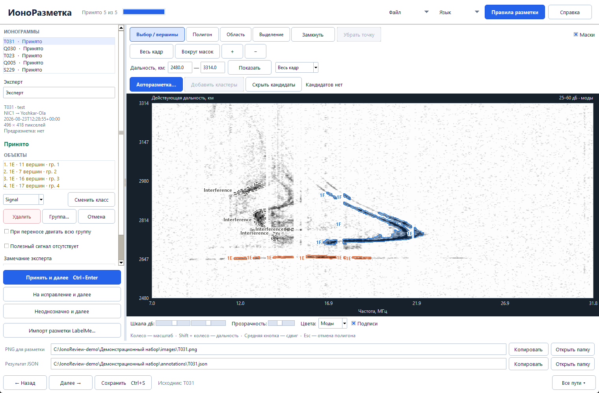
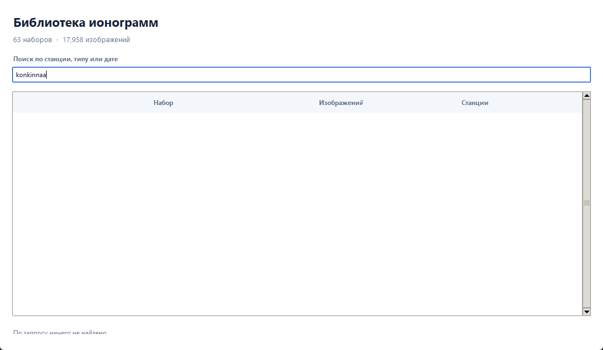
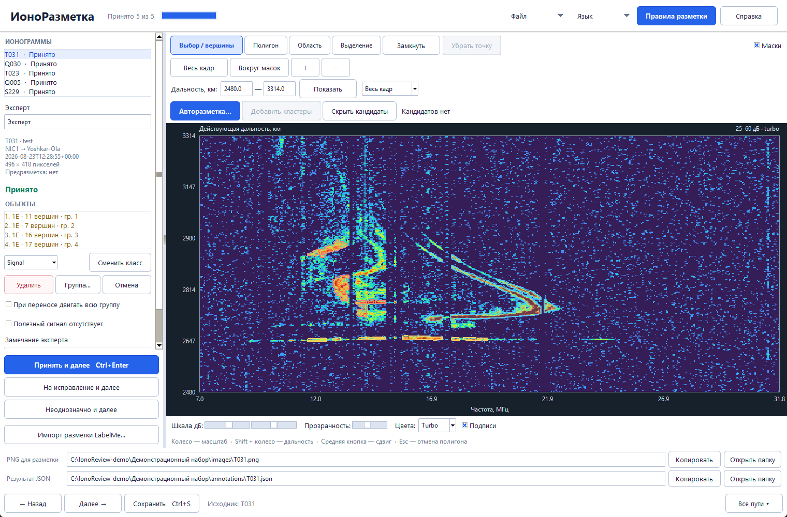
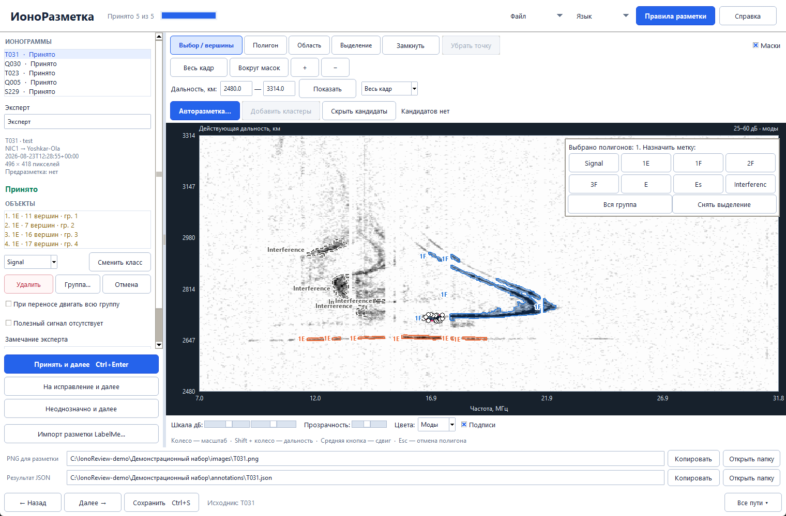
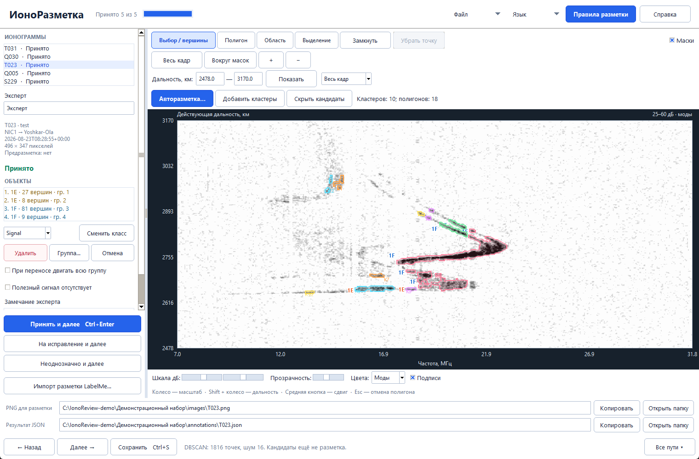
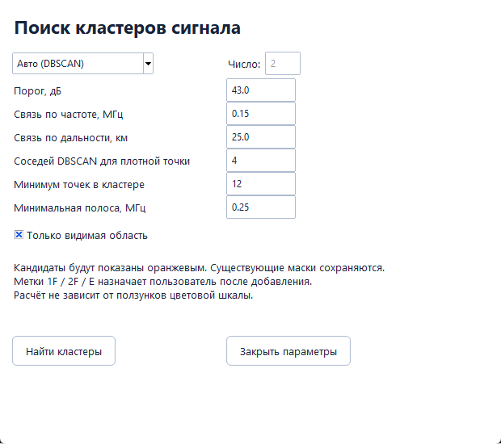
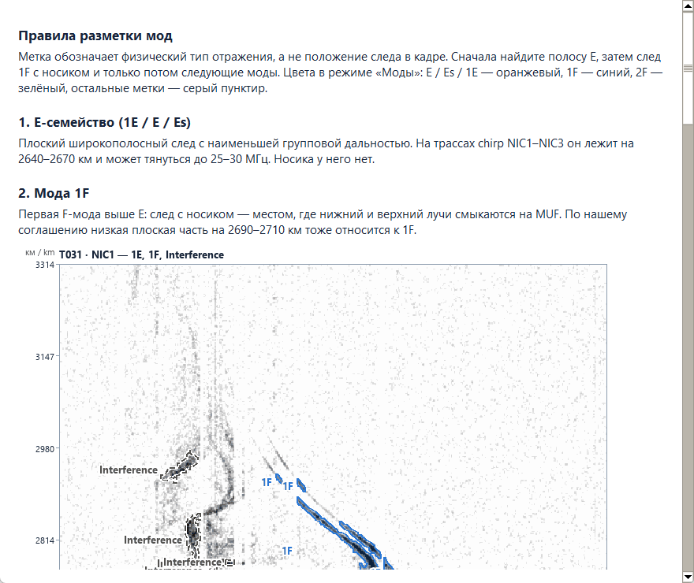
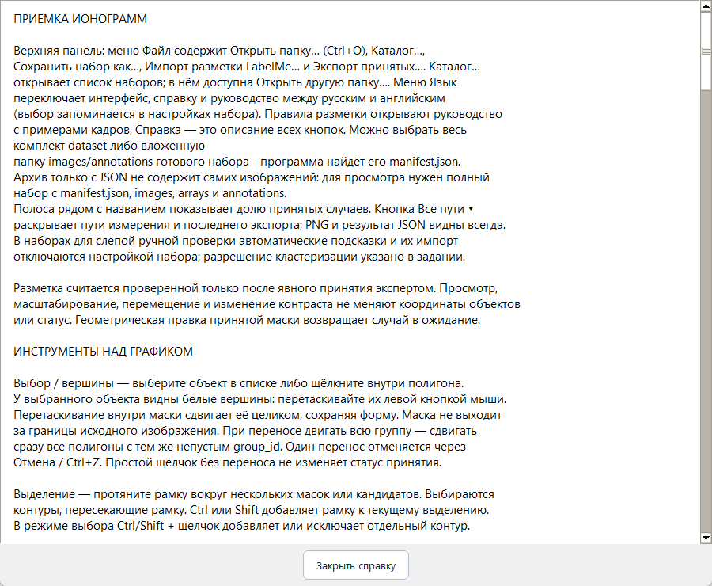
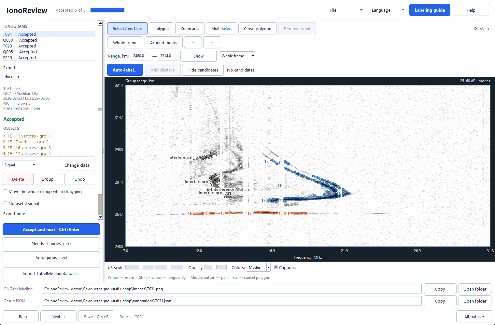

# ИоноРазметка: руководство пользователя

ИоноРазметка — настольная программа для разметки и экспертной приёмки ионограмм наклонного зондирования. Оператор обводит следы сигнала полигонами, назначает им моды распространения (E, 1F, 2F и другие метки) и принимает кадр. Программа хранит измерения, оси, разметку, автора и историю правок в переносимом наборе. Все данные обрабатываются локально.

Описание относится к версии 0.2.0. Все скриншоты сняты в этой версии на демонстрационном наборе из пяти кадров трассы NIC1 → Йошкар-Ола. Их можно переснять командой из раздела «Как обновить скриншоты».



## Содержание

1. [Установка и запуск](#установка-и-запуск)
2. [Набор данных](#набор-данных)
3. [Каталог наборов](#каталог-наборов)
4. [Главное окно](#главное-окно)
5. [Инструменты над графиком](#инструменты-над-графиком)
6. [Просмотр: масштаб, дальность, цвета](#просмотр-масштаб-дальность-цвета)
7. [Метки и выделение](#метки-и-выделение)
8. [Авторазметка DBSCAN и K-means](#авторазметка-dbscan-и-k-means)
9. [Приёмка кадра](#приёмка-кадра)
10. [Правила разметки, справка и язык](#правила-разметки-справка-и-язык)
11. [Сохранение, импорт и экспорт](#сохранение-импорт-и-экспорт)
12. [Клавиши и мышь](#клавиши-и-мышь)
13. [Командная строка](#командная-строка)
14. [Пример работы: разметка кадра от начала до конца](#пример-работы-разметка-кадра-от-начала-до-конца)
15. [Как обновить скриншоты](#как-обновить-скриншоты)

## Установка и запуск

**Готовая сборка для Windows 10/11 x64.** Скачайте `IonoReview-windows-x64.zip` со [страницы релизов](https://github.com/nikita-konkin/ionoreview/releases/latest), распакуйте архив целиком и запустите `IonoReview/IonoReview.exe`. Папка `_internal` должна лежать рядом с exe. Python не нужен.

**Из исходного кода.** Нужен Python 3.12:

```
pip install -r requirements-review.txt
python -m ionoreview review "путь\к\набору"
python -m ionoreview library "путь\к\каталогу"
```

Если рядом с exe есть `datasets/catalog.json`, программа сразу открывает каталог. Иначе она предлагает выбрать набор, каталог или папку обычных изображений.

## Набор данных

Набор — папка формата `ionoreview/1`:

| Файл или папка | Содержимое |
|---|---|
| `manifest.json` | Список кадров: время, передатчик, приёмник, размер, контрольные суммы, параметры отображения |
| `images/` | PNG для просмотра |
| `arrays/` | NPZ с матрицей мощности в дБ и физическими осями: частота, МГц, и действующая дальность, км |
| `annotations/` | Разметка каждого кадра в JSON, совместимом с LabelMe, со статусом проверки и автором |
| `history/` | Предыдущие версии каждой аннотации; при сохранении старая версия переносится сюда |
| `settings.json` | Имя эксперта, последний открытый кадр и язык интерфейса |

Изображение служит только для показа. Координаты полигонов хранятся в пикселях исходного кадра, а программа пересчитывает их в МГц и км по осям из NPZ. Можно открыть и папку обычных PNG без осей: тогда оси показываются в пикселях.

## Каталог наборов



**Файл → Каталог…** показывает все наборы из `catalog.json`: название, число изображений и станции. Поиск фильтрует список по станции, типу или дате. **Открыть набор** (или двойной щелчок) загружает выбранный набор. **Открыть другую папку…** позволяет выбрать набор вне каталога.

## Главное окно

Окно состоит из пяти частей.

- **Верхняя панель.** Название программы, доля принятых кадров, меню **Файл** и **Язык**, кнопки **Правила разметки** и **Справка**.
- **Левая панель.** Список ионограмм со статусами, имя эксперта, сведения о кадре (передатчик → приёмник, время, размер), статус, список объектов, правка классов и групп, кнопки приёмки.
- **Панель инструментов над графиком.** Инструменты рисования и выбора, масштаб, окно дальности, авторазметка.
- **График.** Ионограмма в физических осях: по горизонтали частота, МГц, по вертикали действующая дальность, км. Справа вверху — границы цветовой шкалы и выбранная схема.
- **Нижняя панель.** Шкала дБ, прозрачность масок, схема цветов, подписи, пути к PNG и JSON текущего кадра, кнопки перехода и сохранения.

Кнопки выделены рамкой. Основное действие на каждой панели — синяя кнопка, удаление — красная рамка. Активный инструмент подсвечен синим.

## Инструменты над графиком

| Инструмент | Назначение |
|---|---|
| **Выбор / вершины** | Выбор полигона щелчком. У выбранного полигона видны вершины: их можно перетаскивать. Перетаскивание внутри маски сдвигает её целиком |
| **Полигон** | Рисование нового объекта: каждый щелчок добавляет вершину |
| **Область** | Протяните рамку — график приблизит этот участок. Разметка не меняется |
| **Выделение** | Протяните рамку вокруг нескольких масок или кандидатов. Ctrl или Shift добавляет к текущему выделению |
| **Замкнуть** | Завершить полигон из трёх и более точек. То же делают Enter и правая кнопка мыши |
| **Убрать точку** | Удалить последнюю вершину незамкнутого полигона. То же делают Backspace и Ctrl+Z во время рисования |
| **Маски** | Показать или скрыть разметку, чтобы посмотреть исходный сигнал |

## Просмотр: масштаб, дальность, цвета

- **Весь кадр** показывает весь диапазон, **Вокруг масок** — выбранный полигон или все маски с полями, **+** и **−** меняют масштаб относительно центра.
- **Дальность, км** — нижняя и верхняя границы показа. **Показать** или Enter применяет их. Список справа содержит готовые окна: 1000–5000, 2500–3000, 2700–3100 км и другие.
- Колесо мыши меняет масштаб у курсора, Shift + колесо — только дальность, средняя кнопка сдвигает вид. Увеличение показывает исходные пиксели без сглаживания.
- **Шкала дБ** — два ползунка границ цветовой шкалы. **Прозрачность** — плотность заливки масок. Меняется только отображение, а не данные.
- **Цвета** выбирает схему.

**Схема «Моды»** (по умолчанию) выводит ионограмму в оттенках серого. Маски E-семейства (E, Es, 1E) оранжевые, 1F синие, 2F зелёные. Остальные метки (Signal, Interference, 3F) показаны серым пунктиром без заливки. Флажок **Подписи** печатает класс рядом с каждой маской. По такой схеме сразу видна лестница мод: E внизу, над ней 1F, выше 2F.

**Схема «Turbo»** — прежняя цветная шкала мощности, где у каждой метки свой яркий цвет. Она удобна, когда важнее различать уровни сигнала.



## Метки и выделение



После выбора одного или нескольких полигонов на графике появляется меню меток: **Signal, 1E, 1F, 2F, 3F, E, Es, Interference**. Нажатие кнопки назначает метку всем выделенным полигонам за одно действие. **Вся группа** расширяет выделение на все части группы. **Снять выделение** закрывает меню. Правый щелчок по выделению открывает меню снова.

Смысл меток:

- **E, Es, 1E** — E-семейство. В задаче трёх классов они объединяются в E.
- **1F, 2F, 3F** — односкачковая, двухскачковая и трёхскачковая F-моды, а не подслои F1 и F2.
- **Signal** — сигнал виден, но мода не установлена.
- **Interference** — помехи: вертикальные линии узкополосных станций и другие неионосферные отметки.

В левой панели доступны те же действия:

- **Сменить класс** — назначить класс из списка всем выделенным объектам.
- **Удалить** — удалить выделенные полигоны или отклонить кандидатов. То же делает Delete.
- **Группа…** — объединить части одной моды общим номером группы.
- **Отмена** — отменить последнее действие. То же делает Ctrl+Z.
- **При переносе двигать всю группу** — сдвигать сразу все части группы.

## Авторазметка DBSCAN и K-means



**Авторазметка…** открывает окно параметров поиска кластеров сигнала.



| Параметр | Смысл |
|---|---|
| Метод | **Авто (DBSCAN)** — число групп определяется само; **K-means** — задаётся поле **Число** |
| Порог, дБ | В поиске участвуют только точки сильнее порога. Ниже порог — больше слабого сигнала и шума |
| Связь по частоте, МГц, и по дальности, км | Насколько далеко могут стоять соседние точки одного кластера. Меньшая связь по дальности разделяет близкие по задержке следы, но слишком малая дробит одну полосу |
| Соседей DBSCAN для плотной точки | Сколько соседей нужно точке, чтобы считаться ядром кластера |
| Минимум точек в кластере, минимальная полоса, МГц | Отбрасывают мелкие фрагменты |
| Только видимая область | Искать только в текущем окне графика |

Кандидаты показываются цветными контурами и ещё не являются разметкой: в строке состояния видно число кластеров и полигонов. **Добавить кластеры** превращает их в полигоны с меткой Signal. **Скрыть кандидаты** убирает предпросмотр. Классы назначает эксперт: кластер — это геометрическое предложение, а не физическая мода.

В наборах для слепой проверки (`assistance_disabled: true` в манифесте) авторазметка и импорт чужой разметки отключены.

## Приёмка кадра

Статус кадра показан под сведениями о нём и в списке ионограмм. Кнопки внизу левой панели:

- **Принять и далее** (Ctrl+Enter) — разметка верна; кадр получает статус «Принято», программа переходит к следующему.
- **На исправление и далее** — разметке нужны правки.
- **Неоднозначно и далее** — интерпретация спорная.

Принятие требует имени в поле **Эксперт**. Флажок **Полезный сигнал отсутствует** отмечает кадр без сигнала: пустая разметка сама по себе не означает отсутствия сигнала. В поле **Замечание эксперта** записывается комментарий. Просмотр, масштаб и контраст не меняют статус, а геометрическая правка принятой маски возвращает кадр в ожидание.

## Правила разметки, справка и язык



**Правила разметки** открывают руководство с примерами на реальных кадрах. Главное правило: метка ставится по всей лестнице следов кадра.

1. Сначала найдите плоский широкополосный след с наименьшей групповой дальностью — это E-семейство. На трассах NIC1–NIC3 он лежит около 2640–2670 км.
2. Выше лежит 1F — след с «носиком», где нижний и верхний лучи смыкаются на максимальной применимой частоте.
3. С номером скачка групповая дальность растёт, а МПЧ падает: МПЧ(1F) > МПЧ(2F) > МПЧ(3F).
4. Если E нет, первый F-след всё равно 1F.

В кадрах с неоткалиброванной шкалой дальности судите по относительной лестнице мод, а не по абсолютным километрам.

**Справка** описывает каждую кнопку и поле программы.



Меню **Язык** переключает интерфейс, справку и правила между русским и английским. Выбор сохраняется в `settings.json` набора.



## Сохранение, импорт и экспорт

- **Сохранить** (Ctrl+S) записывает JSON текущего кадра. При переходе к другому кадру правки сохраняются автоматически. Каждое сохранение переносит прежнюю версию в `history/`.
- Строки **PNG для разметки** и **Результат JSON** показывают файлы текущего кадра. **Копировать** копирует путь, **Открыть папку** открывает его в проводнике. **Все пути ▾** показывает также исходное измерение и последний экспорт.
- **Файл → Открыть папку…** (Ctrl+O) открывает другой набор. Можно выбрать сам набор или его вложенную папку `images` или `annotations`.
- **Файл → Сохранить набор как…** копирует набор в новую папку.
- **Файл → Импорт разметки LabelMe…** загружает чужую разметку как предварительную: она требует приёмки экспертом.
- **Файл → Экспорт принятых…** выгружает только принятые аннотации.

## Клавиши и мышь

| Действие | Клавиши и мышь |
|---|---|
| Открыть набор | Ctrl+O |
| Сохранить | Ctrl+S |
| Принять и перейти к следующему | Ctrl+Enter |
| Отменить действие или убрать точку при рисовании | Ctrl+Z |
| Выделить все маски | Ctrl+A на графике |
| Удалить выделенное | Delete |
| Замкнуть полигон | Enter или правая кнопка мыши |
| Убрать последнюю точку | Backspace |
| Отменить незавершённый полигон | Esc |
| Масштаб у курсора | Колесо мыши |
| Масштаб только по дальности | Shift + колесо |
| Сдвиг вида | Средняя кнопка с перетаскиванием |
| Добавить к выделению | Ctrl или Shift + щелчок или рамка |

## Командная строка

| Команда | Назначение |
|---|---|
| `python -m ionoreview review НАБОР` | Открыть набор в разметчике |
| `python -m ionoreview library КАТАЛОГ` | Открыть каталог наборов |
| `python -m ionoreview prepare ФАЙЛЫ --out НАБОР` | Подготовить набор из измерений LFS/HDF5: PNG, NPZ с осями и манифест |
| `python -m ionoreview import НАБОР КАДР ФАЙЛ.json --author ИМЯ` | Импортировать разметку LabelMe как предварительную |
| `python -m ionoreview export НАБОР ПАПКА` | Экспортировать принятые аннотации |

## Пример работы: разметка кадра от начала до конца

1. Откройте набор через каталог или Ctrl+O. Введите имя в поле **Эксперт**.
2. Выберите кадр в списке **Ионограммы**. Схема **Моды** включена по умолчанию.
3. Нажмите **Авторазметка…**, оставьте параметры по умолчанию и нажмите **Найти кластеры**. Проверьте кандидатов на графике.
4. Нажмите **Добавить кластеры**. Кандидаты станут полигонами Signal.
5. Включите **Выделение** и обведите рамкой фрагменты плоского нижнего следа. В меню меток нажмите **1E**. Фрагменты станут оранжевыми.
6. Так же выделите след с «носиком» и нажмите **1F**, затем следующий след выше и нажмите **2F**.
7. Вертикальные полосы станций отметьте **Interference**, лишние фрагменты удалите клавишей Delete.
8. Если кластер захватил две моды, исправьте вершины в режиме **Выбор / вершины** или дорисуйте недостающую часть инструментом **Полигон**.
9. Проверьте лестницу при включённых **Подписях**: E внизу, над ней 1F, выше 2F.
10. Нажмите **Принять и далее** (Ctrl+Enter). Кадр получит статус «Принято», программа откроет следующий.

## Как обновить скриншоты

Скриншоты снимает скрипт из любого набора с размеченными кадрами T031, Q030, T023, Q005 и S229 и каталога `datasets`:

```
python tools/capture_screenshots.py ПУТЬ\К\НАБОРУ datasets docs/annotator/screenshots
```

Скрипт собирает временный демонстрационный набор в `C:\IonoReview-demo`, открывает окна программы, снимает их и удаляет временную папку. Во время съёмки окна нельзя перекрывать.

Значок приложения рисует `python tools/render_icon.py ionoreview/assets/icon`, примеры для правил разметки — `python tools/render_guide_examples.py ionoreview/assets/guide`.
